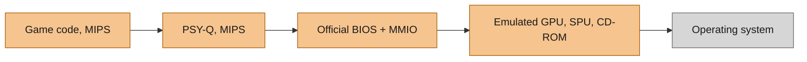
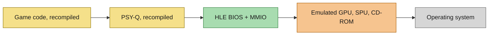
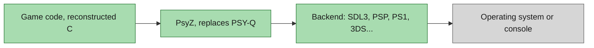

# PsyZ

PsyZ is a drop-in replacement for the PlayStation 1 Runtime Library called PSY-Q, allowing games designed for the PlayStation 1 to be compiled and run natively on any other platform.

PsyZ is not an emulator or a static recompiler. It is a porting library written in C that replaces the PSY-Q API with native counterparts. Currently, it targets multiple platforms, supporting both 32-bit and 64-bit architectures out of the box. The same applications and games will work on all platforms, including the PlayStation 1, with minimal changes.

PsyZ adheres to the PSY-Q library contracts, focusing on compatibility rather than accuracy. It does not aim to produce 1:1 output compared to real hardware and does not reproduce game bugs that rely on misuse of the PlayStation 1 hardware. The goal is to help port games and run them as native applications everywhere.

PsyZ also offers a GPU and SPU emulation layer, accessible through a list of emulated MMIO endpoints. It is theoretically possible to use PsyZ as a backend for new emulators and static recompilers.

## Supported platforms

The platforms currently supported include:

- **Linux** (i686, x86_64)
- **macOS** (ARM64)
- **iOS / iPadOS** (ARM64)
- **WebAssembly / WebGL 2** via Emscripten
- **Windows** (x86, x64, ARM64) with support for MSVC, Clang, and MinGW
- **PlayStation Portable** via its [dedicated backend](psyz/src/psp/README.md)

PsyZ is designed to be extensible, and support for additional platforms may be added in the future.

### Automated rendering without a visible window

With the SDL3 GPU backend, `PSYZ_HEADLESS=1` selects the deterministic
software rasterizer at native resolution. `PSYZ_HEADLESS=gpu` instead keeps
an SDL window hidden, renders with the actual GPU backend, and disables
swapchain presentation and frame limiting. This permits internal-resolution
tests on systems where the SDL `offscreen` video driver cannot create a GPU
device. It still requires a working native video driver and GPU.

The legacy `Psyz_VideoAllocCapturedFrame` API and `StoreImage` retain native
resolution. `Psyz_VideoAllocRenderedFrame` returns RGB888 pixels from the
rendered display region before window/aspect scaling, including internal
resolution detail. Free the returned allocation with `free`. RGB24 movies,
software rendering, and PSP retain native dimensions. Both dimension pointers
are required; failure returns NULL and clears valid output dimensions.
Selecting GPU mode alone does not verify image detail or gameplay parity.
The SDL3 GPU renderer draws native VRAM independently of the scaled target,
so texture feedback and readback retain native sampling. Polygon attribute
planes use signed 12-bit fractional gradients and the original half-unit
bias. Translucent primitives sample the covered destination region and apply
integer RGB555 blending in draw order, including truncation and saturation.
Opaque groups retain the texture mask bit through a separate alpha write.
At native 1:1 sampling, a half-LSB correction on the 12-bit attribute lattice
prevents floating interpolation from moving exact UV/color boundaries down.

### Pixel-exact native rendering

The CPU rasterizer (`sdl3_software.c`) reproduces the PS1 GPU bit for bit:
triangles are scanned in two halves with 32.32 fixed-point edges (top/left
inclusive, bottom/right exclusive), colours and texture coordinates step by
12.12 gradients from a half-unit bias at the leftmost vertex, quads are the
triangles (v0,v1,v2) and (v2,v1,v3), polygons spanning 1024+ columns or
512+ rows are not drawn, lines step a 32.32 position along the major axis and
are always dithered when dithering is on, a textured polygon's page becomes
the drawing mode for later sprites, rectangle positions wrap to 11 bits, fills
(GP0 02h) round X down and the width up to 16 pixels and ignore the mask
settings, and uploads/copies follow the mask bit. libgpu cuts VRAM transfers
and fills that run past the right or bottom edge into wrapped pieces (x modulo
1024, y modulo 512) for every backend. With `Psyz_VideoSetNativeRasterizer(1)`
the SDL3 GPU backend draws with this rasterizer whenever the internal
resolution is 1 and no GPU-only enhancement is on, uploads the CPU VRAM each
frame and presents it through its usual display pipeline; higher internal
resolutions and the enhancements draw with the GPU rasterizer. Presented and
captured RGB555 channels show as round(c * 255 / 31).

`Psyz_GpuDumpBegin`/`Psyz_GpuDumpEnd` record the GP0/GP1 commands with the
starting VRAM and drawing state as a GPUDUMP file (`.psxgpu`). DuckStation
replays it (`duckstation-regtest -frames 1 file.psxgpu`), so a frame's VRAM can
be compared pixel for pixel with its software GPU. The test
`gpu::native_rasterization_matches_ps1_gpu` uses such a replay as its golden
frame (`PSYZ_TEST_GPU_DUMP=file` records the test's commands).

GPU shader headers can be regenerated with
`sh psyz/src/platform/shaders/build_shaders.sh` using glslangValidator,
SPIRV-Cross, xxd, and either dxc or SDL shadercross. Optional shader names
(for example `psx.vert psx.frag`) limit regeneration to those shaders.

## PSY-Q decomp

To achieve a high level of API compatibility and accuracy, PsyZ uses decompiled PSY-Q code that matches the original binaries exactly. This decompilation is an ongoing process. Please navigate to the `decomp/` directory for more details.

This decomp is a spin-off of [sotn-decomp psxsdk](https://github.com/Xeeynamo/sotn-decomp/tree/master/src/main/psxsdk) and reuses from the [PSY-Q decomp by Sozud](https://github.com/sozud/psy-q-decomp).

## Integrate PsyZ SDK

Porting a PlayStation 1 game or application to PsyZ requires careful code modifications and build system integration to ensure compatibility across both the original PlayStation 1 hardware and modern platforms.

For a comprehensive guide, please refer to the **[Porting Guide](PORTING_GUIDE.md)**.

You can also look into the `samples/` directory for complete examples on how to set up a project to target both PlayStation 1 hardware and PsyZ on PC.

## Set up the PsyZ SDK

At the root of the directory run `make -j`. This will download PSY-Q SDK 4.7 and populate `nugget/psyq` with the transformed `include` and `lib` folders. PCSX Redux will also be downloaded to compile the tool `psyq-obj-parser`, necessary to generate the libraries. This might take a while.

This step is needed to cross-compile your source code against both PsyZ and PSY-Q. If you are not interested in cross-compiling your homebrew to both PlayStation 1 and PC, you can skip this step.

## Samples

Most of these examples are adaptations of the original PSY-Q SDK samples, designed to target both PS1 and all PsyZ platforms. This is achieved via [nugget](https://github.com/pcsx-redux/nugget).

These samples are frequently used to test the quality of PsyZ, assess its feature set and catch regressions.

## Architecture

### How PsyZ compares to an emulator and a recomp

- **Emulator**: runs the original game binary. It interprets (or recompiles) the MIPS CPU code at run time, boots the official BIOS and sends every hardware register access (MMIO) to emulated GPU, SPU and CD-ROM chips. PSY-Q is part of the game binary, so it is emulated too.
- **Recomp**: translates the MIPS CPU code into source code ahead of time, so the CPU work moves from run time to build time. The BIOS is replaced by a high-level (HLE) implementation. MMIO and the emulated GPU, SPU and CD-ROM stay the same as in an emulator, and the recompiled PSY-Q still sits between the game and them.
- **PsyZ**: compiles the game's decompiled source code natively. PSY-Q is replaced as a whole by PsyZ, which talks straight to the operating system through a backend. There is no BIOS, no MMIO and no emulated chips, and the same game runs anywhere.

**Emulator**

**Recomp**

**PsyZ**

ORANGE runs emulated at run time. YELLOW is recompiled at build time. GREEN is native code.

|                | PCSX-Redux (interpreter) | PCSX-Redux (dynarec) | SymphonyRecomp | PsyZ (-O3)  |
|----------------|--------------------------|----------------------|----------------|-------------|
| CPU % of usage | 16%                      | 10%                  | 16%            | 1%          |
| Frame render   | 2.67 ms                  | 1.67 ms              | 2.67 ms        | 0.17 ms     |
| GPU % busy     | 9%                       | 10%                  | 7%             | 3%          |
| RAM usage      | 465 MB                   | 473 MB               | 551 MB         | 387 MB      |
| VRAM usage     | 79 MB                    | 79 MB                | 114 MB         | 52 MB       |

- Measurement is done on Castlevania: Symphony of the Night, prologue stage.
- PCSX-Redux: build r7333, commit `55eafd76` (2026-07-18), stock settings, software GPU renderer.
- SymphonyRecomp: v0.5.1b (released 2026-08-19), on .NET 10.0.12.
- PsyZ: version 2026-10-03, through [sotn-decomp](https://github.com/Xeeynamo/sotn-decomp), built with GCC 16 at `-O3`, using hardware VSync.
- AMD Ryzen 9 7900X, GeForce RTX 5080 (driver 615.71.09), CachyOS on Wayland, sampled with `pidstat` once per second for 30 seconds.

### Source tree

The SDK is structured into three major folders:

#### src/psyz

Contains the core of the SDK. The majority of the SDK calls are reimplemented here. Whenever an API call is platform-specific, the call is redirected to an equivalent function with the `My` prefix (e.g., `LoadImage` internally calls `MyLoadImage`). All platform-specific code is located in `src/platform`.

#### src/platform

Platform-specific logic is found here. Each platform uses a subset of the source files in this folder. The build script instructs the linker to decide what platform-specific code needs to be used in the final executable. This means no `#ifdef` spam or function pointers. Everything is statically linked whenever possible.

#### decomp/src

All the code in this folder mirrors the original PSY-Q libraries and it is powered by the matching decompilation of PSY-Q. Currently it targets PSY-Q 4.0.

## Games using PsyZ

- [Castlevania: Symphony of the Night](https://github.com/Xeeynamo/sotn-decomp/)
- [Rayman 1](https://github.com/rayman-decomp/rayman-ps1-decomp/)
- [Final Fantasy VII](https://github.com/Xeeynamo/ff7-decomp)
- [Mega Man X4](https://github.com/sozud/mmx4)
- [Rage Racer](https://github.com/khasinski/rage-racer-psyz)
- [Metal Gear Solid 1](https://grain.saltindex.com/how-i-managed-to-run-metal-gear-solid-ps1-on-a-15-esp32-s3-8ebf2a478e3f), running bare metal on an ESP32

If you want your game to be listed here, please [submit an issue](https://github.com/Xeeynamo/psyz/issues/new).

## Why develop PsyZ?

Before starting this project, I tried using both [libValkyrie](https://github.com/Gh0stBlade/libValkyrie) and [PsyCross](https://github.com/OpenDriver2/PsyCross/). However, each presented its own challenges, such as lack of 64-bit support, insufficient documentation, missing samples, or inflexibility when porting to new platforms. PsyZ aims to solve these issues and more.

I also became increasingly fascinated by the PlayStation 1 hardware due to its simplicity and versatility. This project is a personal opportunity to learn more.

## Contributing

Contributions are welcome! If you find issues or want to add new features, please open an issue or submit a pull request. Ensure that any code you submit adheres to the project's coding standards and includes appropriate documentation.

## Special Thanks

Special thanks to [SoapyMan](https://github.com/SoapyMan) for the inspiration from their [PsyCross](https://github.com/OpenDriver2/PsyCross/) project.

Thanks to [grumpycoders/pcsx-redux](https://github.com/grumpycoders/pcsx-redux/) for their ongoing support to the PS1 development community and help.

Parasite Eve fork: non-dithered fragment output now quantizes RGB channels to
five bits during rasterization instead of leaving an eight-bit value to be
rescaled by VRAM readback. This preserves PS1 truncation, including RGB=248
mapping to channel 31. The OpenGL source and generated Metal, SPIR-V and DXIL
fragment headers share the change. Parent-project GPU regression covers all
256 input values of each RGB channel in both native draw buffers. Metal runtime
and GLSL 330/GLES 300 syntax are verified; Vulkan/Direct3D runtime and OpenGL
runtime remain unverified here (the macOS build rejects the OpenGL backend).

Reference: [PSX GPU color conversion](https://psx-spx.consoledev.net/ps1/gpu/i-o-ports-dma-channels-commands-vram/).

Parasite Eve fork: SDK VSync(n>1) now waits against the blank counter relative
to the previous blocking synchronization, with a minimum of one new blank.
Presents, controller sampling, callback delivery and kernel blank service follow
the counter's actual progress. Mode 1 remains a horizontal-line query, and
negative modes remain counter queries. In SDL limitless mode, explicit presents
advance the blank counter deterministically; switching pacing modes preserves
counter continuity. The parent regression checks modes 0/1/2/4, no query-side
advancement, callback counts and an already-elapsed interval. Metal runtime
passes with libapi.c and sdl3_gpu.c instrumented by ASan/UBSan/function. Hardware
scanline precision and autonomous blank interrupts while no synchronization
call is executing are not established by these checks.

### Observing playback audio

`Psyz_AudioSetCaptureCallback` observes the existing mixed 44100 Hz stereo
signed-16-bit playback frames in host byte order, without another SPU pull.
It also works with `PSYZ_AUDIO_CLOCK=video`. The callback runs under the audio
lock; copy/consume its temporary buffer without modifying it or calling
Audio/SPU APIs. Detach with a NULL callback before releasing its userdata.
`Psyz_AudioDestroy` clears registration. Direct `Psyz_SpuPullSamples` calls
bypass the observer. This captures emulator output; it is not a hardware
accuracy oracle.

With `PSYZ_AUDIO_CLOCK=video` set at process startup, emulated root counters
also use the sample clock, with no host timer thread. Mixing splits at timer
edges so handlers can update voices within a video frame. Host delays and
clock queries do not advance this time. Native synchronous waits that depend
on a timer can call `Psyz_AudioWaitForTimer`: it generates a bounded block up
to the next timer edge without advancing VBlank; real-time/paused backends
return zero and continue using their normal polling/waiting path. Configure
the clock before initializing the kernel; changing it during a run is unsupported.
